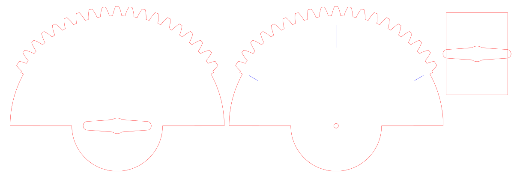
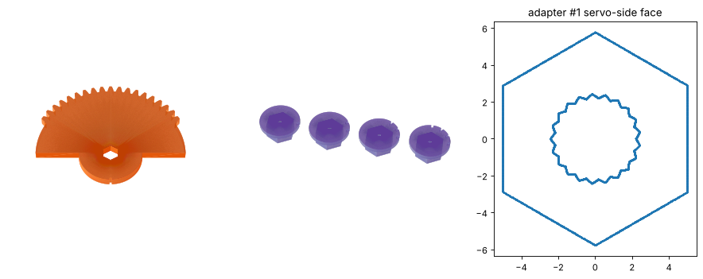
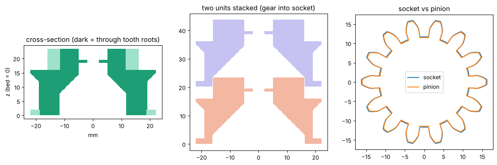

# Week 11 · Nov 8 — Finding the sector gear: wind, wind, let go

[← Previous](2026-11-07.md) · [The Last Leaf index](README.md) · [Next →](2026-11-09.md)

**Goal:** find one mechanism that holds the leaf up, drops it suddenly, and winds it back.

## What I did

- Tried a pulley that turns back and forth and then lets go: it has the same problem as the cams
  (nothing releases the line).
- Found the answer: a **sector gear** (also called an intermittent or mutilated gear), with teeth
  on only part of its edge. While the teeth mesh, the servo drives the spool. When the servo turns
  into the tooth-less part, the spool spins free and the leaf falls.
- Modelled the gears: module 2, a 56-tooth full-circle equivalent with teeth only from 30° to
  150° (19 teeth), driving a 14-tooth pinion — a 1:4 ratio.
- 3D-printed version of the sector gear that fits the metal servo spline directly, plus spline
  adapters, a printed axle (I had no steel rod or screws) and a stackable spool.

## Decisions and why

- **Gaps on both ends of the gear.** A 180° servo can't keep turning one way. Insight: fishing line
  can wind on a spool in *either* direction. So the gear has a gap at each end: after a drop on one
  side, the servo winds the leaf back up from the other side.
- **Print what touches the servo, laser-cut the rest.** A laser-cut wooden gear can't grip the tiny
  metal spline, so the part on the servo is printed.

## Other ideas noted

- An enclosure like a pergola: a lattice on top only, so the drop zone stays clean.
- Using backlash between gears to delay motion, and elastic cord instead of fishing line.

**Next:** print all the parts and test the servo by itself.
