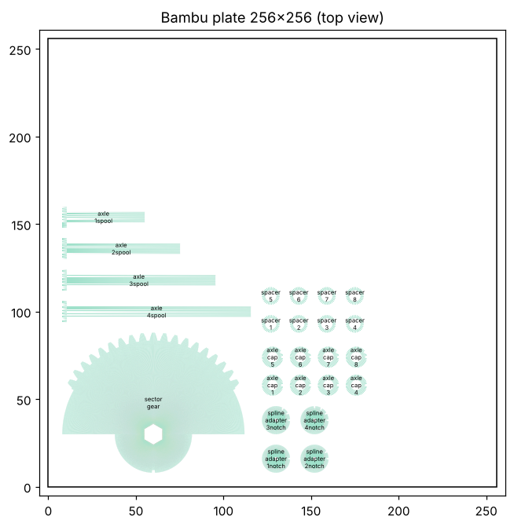

# Week 12 · Nov 9 — First print plate and the first servo test

[← Previous](2026-11-08.md) · [The Last Leaf index](README.md) · [Next →](2026-11-10.md)

**Goal:** print the mechanism parts and make the servo move under my control.

## What I did

- Put every printed part except the leaf gear on one Bambu Studio plate: sector gear, spline
  adapters, axles, caps and spacers.
- Wrote a servo test sketch: type an angle in the Serial Monitor and the servo moves there
  slowly; `+`/`-` steps 5°, `d` lets the servo go limp so I can turn the gear by hand.
- Worked out the wiring: servo signal on pin 9, a separate 5 V supply recommended, common ground,
  and a capacitor across the servo's power. My 100 µF / 35 V capacitor is fine.

## Decisions and why

- **Serial control only, no button.** I first wanted a button to switch to the swaying mode, then
  decided typing commands in the Serial Monitor is faster for testing and needs no extra wiring.

<!-- TODO photo: printed parts off the plate -->
<!-- TODO photo: servo test on the breadboard -->

**Next:** build a first physical prototype of the leaf.
