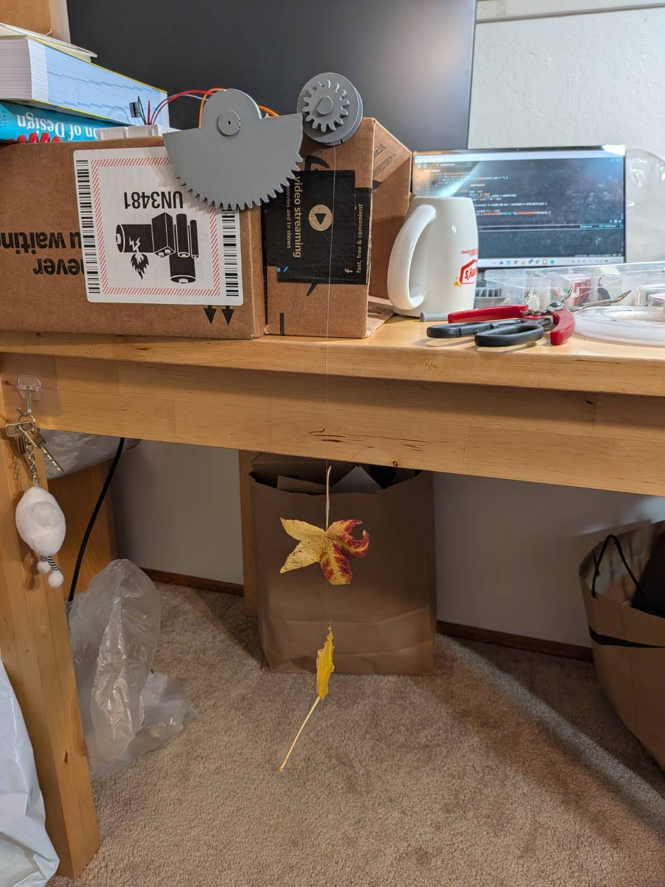
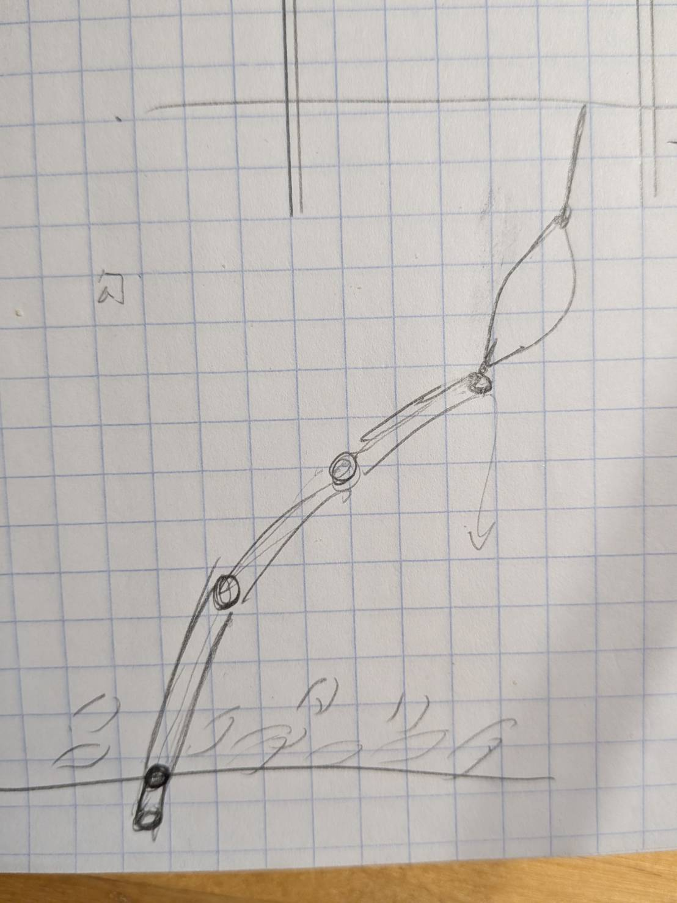
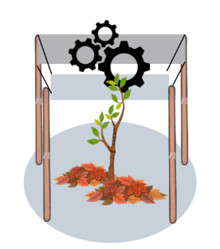
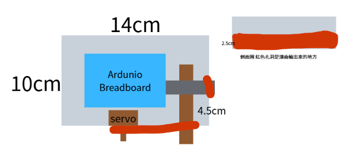
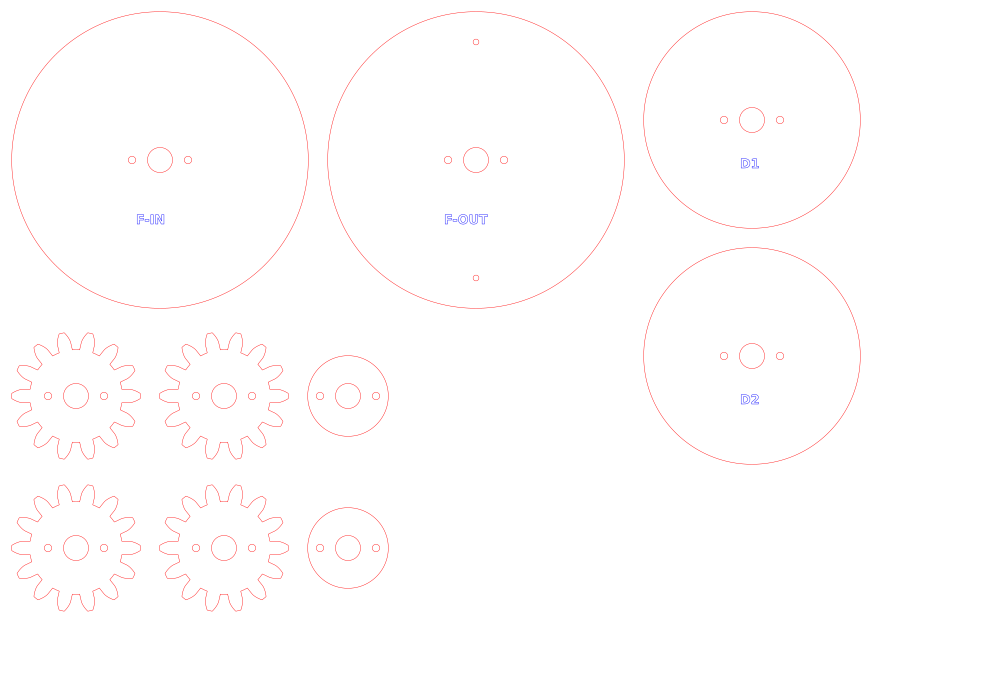
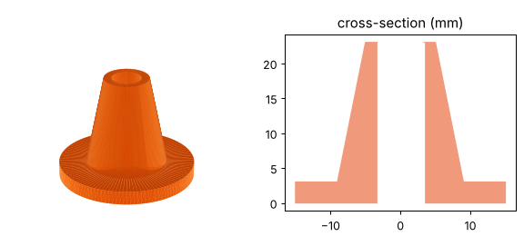
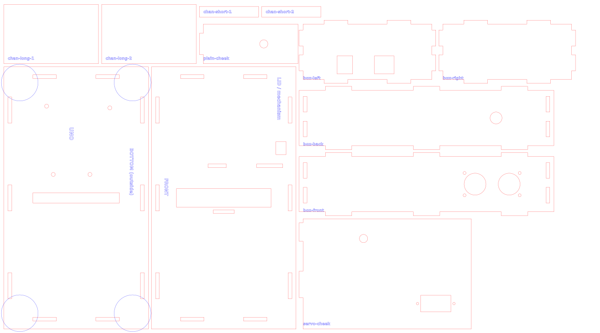
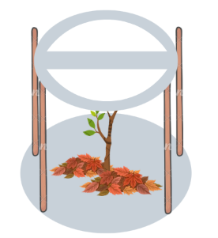
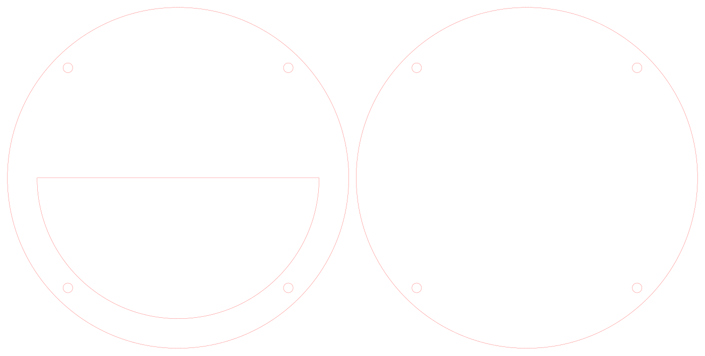

# Week 12 · Nov 10 — Branch v1, the screen, the frame, and the first drop

[← Previous](2026-11-09.md) · [The Last Leaf index](README.md) · [Next →](2026-11-11.md)

**Goal:** a first version of every part — the physical leaf, the screen, the frame, the code — and
a first real drop.

## Morning: what should actually move?

My first prototype photo looked plain: one leaf on a line didn't read as a tree.

- Thought about how many leaves per line, single leaves vs clusters, and flapping two pieces
  (but it shouldn't look like a bird). Liked a jointed branch.
- Re-docking a separate leaf onto a branch after it falls seemed too hard to make reliable.
- **Decision — branch v1:** the leaf is fixed to one real branch hinged at the base, and one line
  pulls the branch tip up. On a drop the whole branch falls flat, which reads as a stronger
  moment than a small leaf.

## Afternoon: the screen (p5.js)

- Scene 1: a bare tree with leaves drifting down; leaves painted by earlier visitors stay on the
  branches. Scene 2: the screen goes dark, a sketched leaf fades in, and the visitor paints inside
  it with a fingertip (ml5 hand tracking). Scene 3: the painted leaf flies back onto a branch.
- **Iteration on the visitor's figure:** filled shape → stick figure → light-grey pencil scribble,
  no face and no shoulder bumps, so the person stays abstract. The brush starts orange, then
  visitors can pick from a palette.
- **Problem:** the p5 web editor stopped the sketch with "`_LP15` is not defined" — its
  infinite-loop protection. Fixed with `// noprotect` and braces on every loop.

## Afternoon: the frame and the spool

- **Spool sized for the lift:** drum radius 27 mm gives about 20 cm of lift over 108° of servo,
  leaving room for the breathing motion; 1/8" plywood; a 28 cm drop zone.
- **Scaled back:** my full laser-cut enclosure was too much for now — "print the gears first".
- **Four legs, not three:** three legs put one in the middle of a front-on photo, so no clean
  background. Bought 1/4" dowels; tapered 3D-printed sockets hold them.
- Electronics box on top (inside 14 × 10 × 4.5 cm) with the gears outside its front wall.

## Evening: code and the first drop

- **Compile error** "expected declaration before '}'": my state was named `RISING`, which the
  Arduino core already defines as a constant. Renamed every state with an `S_` prefix.
- Wired the HC-SR04 (Trig D7, Echo D6) and the servo (D9) with a 100 µF capacitor across 5 V/GND.
  Kept the servo on Arduino power: the sensor only draws ~15 mA and it was stable on USB.
- **First drop test** by Serial commands: `drop` jumps into the gap, `swing` winds the leaf up.
  When I flipped the angles, the servo swept through all the teeth before releasing — it looks
  like a sudden gust, and I kept that.
- **Problem:** upload failed with "can't open COM12" — another program held the port.
- **Problem:** after a drop, `swing` stayed on the near side instead of winding from the other
  side. First fix: a one-side version (rest 130°, drop 10°).
- **Platform:** two 23 cm plywood discs; the top is half solid for the box and half open for the
  gears. The gears need about 15 cm where they pass through, so I narrowed the rim from 2.5 cm to
  2 cm (19 cm opening).

**Next:** test the motion on the real gear over several cycles.
